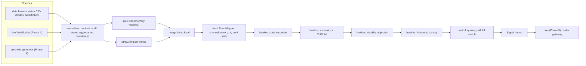
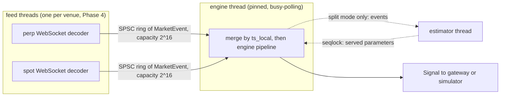

# PulseLOB: Architecture and Engineering Specification

| Field | Value |
|---|---|
| Document version | 0.2.0 |
| Phase | 2 (repository architecture, build system, memory layout, data schemas) |
| Implements | [math_spec.md](math_spec.md), spec version 0.1.0 |
| Status | Draft for review |
| Date | 2026-11-20 |

This document fixes how the mathematics of the spec becomes software. The repository already contains everything below that is marked **(built)**: the build system, the schema and layout types, the SPSC ring buffer, the Python package skeleton and CI. These compile and are tested on Linux (GCC 13, Clang 18) and macOS arm64 (AppleClang). Everything marked **(Phase n)** is specified here and implemented in that phase. Phase 2 contains no model algorithms.

---

## 0. Decisions at a glance

1. **Header-only core, templated on a compile-time model shape.** `ModelShape<D, r_1..r_Q>` fixes the channel count and the kernel orders, so every state array has a size known at compile time. That gives zero allocation after construction by construction rather than by discipline. Decay rates and all other parameters are runtime configuration.
2. **No C++20 named modules.** Component boundaries are directories, namespaces and CMake targets. CI enforces them with an include-layering check and by compiling every public header standalone with `-fno-exceptions -fno-rtti` (Section 2.3).
3. **Own fixed-size matrices, not Eigen.** Rows are padded to 64 bytes and the padding lanes are kept at zero, so the five kernels the estimator needs run full-width SIMD loops with no remainder handling (Section 5.2).
4. **Exact integers at the edges, doubles inside.** Timestamps are `int64` nanoseconds. Prices and quantities are `int64` fixed-point with scale $10^{-8}$, which is exact for every Binance value. The model computes in IEEE double with no fast-math and no FMA contraction, so a run is reproducible (Section 4.3).
5. **One 64-byte event record everywhere.** The same `MarketEvent` bytes serve as ring slots, NumPy structured arrays and memory-mapped `.plev` files. Ingestion is zero-copy from a file all the way to the engine (Section 7).
6. **Arrays of structures for transport, structures of arrays for model state.** Events are consumed whole, while model state is swept across channels and coordinates (Section 5.1).
7. **Deterministic single-threaded engine by default.** Optionally, the estimator moves to a second core and publishes parameters through a seqlock; this resolves decision 4 of the math spec (Section 6). Backtests and tests always use the deterministic mode.
8. **128-byte false-sharing separation.** This covers the 128-byte cache lines of Apple M-series cores, measured on the development machine, and x86 adjacent-line prefetching. Data arrays use 64-byte alignment.
9. **No exceptions or RTTI on the hot path.** Errors are status codes plus counters. Configuration is validated at construction, which may throw because it is cold code.
10. **Python packaging via scikit-build-core and pybind11**, with the version read from `VERSION`.
11. **A data constraint found in this phase.** Binance's public archives have **no spot top-of-book data at any date**. They have futures top-of-book only for 2023-05-16 to 2024-03-30 (BTCUSDT). This affects Phases 4 and 5; Section 7.4 gives the options.

---

## 1. Repository layout

```text
PulseLOB/
├── CMakeLists.txt                 root build: core target, header contract, sub-projects  (built)
├── CMakePresets.json              debug / asan / tsan / release / bench presets            (built)
├── cmake/                         options, warnings + FP policy, sanitizers, pinned deps   (built)
├── include/pulselob/              public C++ headers (header-only core)
│   ├── version.hpp.in             generated from VERSION                                   (built)
│   ├── core/                      platform constants, time, fixed point, fixed matrices,
│   │                              model shape                                              (built)
│   ├── feed/                      MarketEvent schema, SPSC ring                             (built)
│   │                              event mapper, merger                                      (Phase 3/4)
│   ├── hawkes/                    kernel bank, state, estimator, stability, forecaster     (Phase 3)
│   ├── control/                   quoting law, pull state machine                          (Phase 3)
│   ├── engine/                    per-event pipeline, replay driver, counters              (Phase 3)
│   └── sim/                       market-making simulator                                  (Phase 5)
├── bindings/module.cpp            pybind11 module pulselob._core                           (built)
├── python/pulselob/               Python package: schema, .plev I/O                        (built)
│                                  config, data loaders, generators, simulator, analysis    (Phase 3–6)
├── tests/cpp/                     GoogleTest unit tests                                    (built)
├── tests/python/                  pytest tests                                             (built)
├── bench/                         Google Benchmark micro-benchmarks                        (built)
├── docs/                          math_spec.md (Phase 1), architecture.md (this document)
├── research/                      numerical validation of the math spec (Phase 1)
├── scripts/                       version and layering checks                              (built)
├── pyproject.toml                 Python build (scikit-build-core)                         (built)
└── .github/workflows/             CI, weekly research run, tag-driven releases             (built)
```

The prompt for this project suggested `include/hawkes_toxicity/`. The headers live under `include/pulselob/` instead, to match the project and package name.

---

## 2. Component architecture

### 2.1 Components

| Component (namespace) | Responsibility | Spec sections | May depend on | Phase |
|---|---|---|---|---|
| `core` | platform constants, time, fixed point, fixed-size matrices, model shape, ψ functions, small linear-algebra kernels, FP environment | 4.2, 4.6–4.8 | standard library only | 2 (types), 3 (kernels) |
| `feed` | `MarketEvent` schema and validation, SPSC ring, event mapper (channel and mark from events and book state), stream merger | 2.2, 2.3, 4.4, 4.5 | `core` | 2 (schema, ring), 3/4 |
| `hawkes` | kernel bank and state recursion, compensators, least-squares estimator (Potter, ridge replenishment), CUSUM, stability projection, forecasts and toxicity | 3–7 | `core` | 3 |
| `control` | quoting law, pull and kill-switch state machines, message throttling | 8 | `core`, `hawkes` | 3 |
| `engine` | per-event pipeline (spec Section 9), counters, snapshot/restore, replay driver | 9 | `core`, `feed`, `hawkes`, `control` | 3 |
| `sim` | latency and queue-position simulator, fills, fees, PnL, markouts | (Phase 5 spec) | `core`, `feed`, `engine` | 5 |
| bindings | pybind11 module | – | everything | 2 (schema), 3–5 |

`hawkes` does not know about markets: it sees channels, times and marks. `feed` turns market events into those. This keeps the model testable against the spec's definitions without any market-data plumbing.

### 2.2 Data flow



### 2.3 How the boundaries are enforced (built)

* **Layering.** [`scripts/check_layering.py`](../scripts/check_layering.py) parses every `#include` under `include/pulselob/<component>/` and fails CI if a component includes a component not listed for it in Section 2.1, or if a public header includes third-party code.
* **Self-contained, exception-free headers.** CMake generates one translation unit per public header, containing only that `#include`, and compiles all of them as the `pulselob_header_check` target with `-fno-exceptions -fno-rtti` and the full warning set. A header that relies on a transitive include, throws, or uses RTTI fails the build.
* **Why not C++20 named modules.** Module support needs CMake 3.28+ with the Ninja generator, and dependency scanning, which AppleClang has supported unevenly. pybind11 and GoogleTest are not modular, so the build would have to mix modules and headers. Since the engine is templated on the model shape, it must stay header-visible anyway. Every benefit modules would give here (no leaking includes, explicit dependencies) is delivered by the two checks above.

---

## 3. Build system (built)

### 3.1 Targets

| Target | Kind | Contents |
|---|---|---|
| `pulselob::pulselob` | INTERFACE | public headers, C++20, FP policy (Section 4.3) |
| `pulselob::warnings` | INTERFACE | warning set for PulseLOB's own code only |
| `pulselob_header_check` | OBJECT | one TU per public header, `-fno-exceptions -fno-rtti` |
| `pulselob_tests` | executable | GoogleTest unit tests, registered with CTest |
| `pulselob_bench` | executable | Google Benchmark micro-benchmarks |
| `_core` | Python module | pybind11 extension, installed as `pulselob/_core` |

### 3.2 Options and presets

| Option | Default | Meaning |
|---|---|---|
| `PULSELOB_BUILD_TESTS` | ON | GoogleTest unit tests |
| `PULSELOB_BUILD_BENCHMARKS` | OFF | Google Benchmark |
| `PULSELOB_BUILD_PYTHON` | OFF | pybind11 module (ON under pip) |
| `PULSELOB_WARNINGS_AS_ERRORS` | OFF | `-Werror` (ON in CI) |
| `PULSELOB_NATIVE_ARCH` | OFF | `-march=native` or `-mcpu=native`; benchmarks only |
| `PULSELOB_SANITIZERS` | empty | `address;undefined` or `thread` |

The presets are `debug`, `asan` (Debug with AddressSanitizer and UBSan), `tsan` (RelWithDebInfo with ThreadSanitizer), `release` and `bench` (Release, benchmarks, native tuning). Usage: `cmake --preset release && cmake --build --preset release && ctest --preset release`.

### 3.3 Pinned dependencies

Each dependency is fetched only when its option is on, by URL and SHA-256. The core has no dependencies.

| Dependency | Version | SHA-256 of the GitHub tag archive |
|---|---|---|
| GoogleTest | 1.15.2 | `7b42b4d6ed48810c5362c265a17faebe90dc2373c885e5216439d37927f02926` |
| Google Benchmark | 1.9.1 | `32131c08ee31eeff2c8968d7e874f3cb648034377dfc32a4c377fa8796d84981` |
| pybind11 | 2.13.6 | `e08cb87f4773da97fa7b5f035de8763abc656d87d5773e62f6da0587d1f0ec20` (pip builds use the `pybind11` build requirement instead) |

Third-party code is included with `SYSTEM`, so the project's warning set and `-Werror` never apply to it.

### 3.4 Compiler and platform matrix

| CI job | OS | Compiler | Configuration |
|---|---|---|---|
| C++ gcc-13 release | Ubuntu 24.04 x86-64 | GCC 13 | Release, `-Werror` |
| C++ clang-18 asan+ubsan | Ubuntu 24.04 x86-64 | Clang 18 | Debug, AddressSanitizer + UBSan |
| C++ clang-18 tsan | Ubuntu 24.04 x86-64 | Clang 18 | RelWithDebInfo, ThreadSanitizer |
| C++ appleclang arm64 release | macOS 14 arm64 | AppleClang | Release, `-Werror` |
| Benchmarks compile | Ubuntu 24.04 | GCC 13 | bench preset (built, not run: CI timings are not meaningful) |
| Python | Ubuntu (3.9, 3.12), macOS (3.12) | platform default | `pip install .[test]`, pytest |

The CMake minimum is 3.25 (presets v6, `FetchContent ... SYSTEM`). Development was done with CMake 4.3 and AppleClang 21 on an Apple M4.

---

## 4. Configuration and numerical policy

### 4.1 Compile-time versus runtime configuration

| Compile-time (`ModelShape`) | Runtime (`Config`, validated at construction) |
|---|---|
| channel count $D$ | decay rates $\beta_q$ |
| kernel orders $r_q$ (hence $Q$, $P$, $M+1$) | forgetting half-lives, dwell, CUSUM $\varrho$ and $b_{\mathrm{cs}}$ |
| | ridge $T_\omega$, heartbeat $T_{\mathrm{hb}}$, prior $\boldsymbol\Theta_0$ |
| | $\rho_{\max}$, $\chi$, $\epsilon_v$, $\rho_{\mathrm{crit}}$, $\mu_{\min}$, $\mu_{\max}$ |
| | mark coefficients and caps, normalizer rates |
| | forecast horizon $H$, latency $\mathcal L_{\mathrm{rt}}$, control parameters |
| | channel map (instrument, side) to channel; impact weights $\eta_i$, $J^b_i$, $J^I_i$ |

`DefaultShape = ModelShape<4, 1, 2, 2, 1>` gives $P=17$ and $M+1=7$, matching spec Section 3.1. In Phase 3 the Python binding will instantiate `DefaultShape` and the $Q=3$ all-exponential fallback `ModelShape<4, 1, 1, 1>` ($P=13$), and select between them by name. Erlang orders above 2 are rejected at compile time: they would need $\psi_n$ with $n>3$, which is outside the range validated in Phase 1.

### 4.2 Construction-time validation (Phase 3)

`Config::validate()` rejects any configuration that breaks an assumption of the spec:

* $\kappa_{\max}<\beta_{\min}$ (I2);
* slowest kernel mean $\times10\le$ slow half-life (I3, warning only);
* $\rho_{\max}\chi\bar g<1$ (S4);
* $H\ge\mathcal L_{\mathrm{rt}}$ (Section 7.3);
* $0<\mu_{\min}<\mu_{\max}$; $c_\iota<1$; all rates positive and finite;
* every instrument in the channel map present in the instrument table.

Construction is the only code allowed to throw.

### 4.3 Floating point

* **No fast-math.** The root `CMakeLists.txt` refuses to configure if the flags contain `-ffast-math` or `-Ofast`. These would break the NaN guards and the reassociation-sensitive 1e-10 equivalence tests.
* **No FMA contraction:** `-ffp-contract=off` on every consumer of the core. GCC contracts across statements by default and Clang within expressions, so allowing it would make the same source produce different bits on different compilers. Phase 3 benchmarks will report the cost of this, and a contraction-enabled build is a benchmark-only option.
* **Reproducibility guarantee.** Same platform, same standard math library, same input bytes and same configuration give bitwise-identical output, in single-threaded mode, at any optimization level. Across platforms (for example glibc against Apple libm) `exp` may differ by an ulp, so results agree to rounding, not bitwise.
* **Denormals.** Flush-to-zero is set by an RAII guard on the engine thread: MXCSR FTZ and DAZ on x86-64, FPCR.FZ on AArch64. The Python binding sets it for the duration of a run and restores the interpreter's FP environment afterwards. Phase 3 tests run with and without the guard and require equal results, since the spec's cutoff ($X_{\mathrm{cut}}=50$) keeps denormals out of every meaningful computation.
* **Time.** Differences of `int64` nanosecond stamps convert to seconds by division, not by multiplying by `1e-9` (which is inexact), so the conversion is correctly rounded. **(built: `core/time.hpp`, tested)**

---

## 5. Memory layout

### 5.1 Principles, and SoA versus AoS

| Data | Layout | Reason |
|---|---|---|
| `MarketEvent` in rings, NumPy arrays and `.plev` files | AoS, 64-byte records | consumed whole, one record per event; one layout for all transports means zero copies |
| Model state ($R$, $\boldsymbol\Theta$, $\mathbf U$, $\mathbf C$, vectors) | SoA, padded rows | the recursions sweep one quantity across all channels or coordinates (for example "multiply row $(q,n)$ of $R$ by $e_q$ for all $j$"), which vectorizes only if those values are contiguous |
| `Signal` output | AoS, 128-byte records (for $D=4$) | one record per event for NumPy |
| Cross-thread fields (ring counters, seqlock) | each on its own 128-byte block | no false sharing |

### 5.2 Fixed-size containers (built: `core/fixed_matrix.hpp`)

`FixedMatrix<R, C>` and `FixedVector<N>` are `alignas(64)` structs holding a `std::array<double, ...>`.

* Every row starts on a 64-byte boundary.
* Rows are padded to `stride = round_up(C, 8)` doubles.
* **Padding lanes are zero** at construction, and every kernel must keep them zero. Full-width SIMD loops over `stride` lanes are then exact, because padded products contribute $0\cdot0=0$.
* Nothing allocates. Unit tests check the sizes, the row alignment and the padding invariant.

Eigen was considered and rejected for this role:

* **Padding.** With $P=17$, an Eigen fixed-size matrix neither pads rows nor aligns them for SIMD.
* **Over-alignment pitfalls.** Fixed-size vectorizable Eigen types carry known pitfalls when stored in structs that are themselves heap-allocated.
* **Small surface.** The estimator needs only five kernels: row-wise axpy, matrix-vector product, transposed matrix-vector product, rank-one update and scaling. They are written once in Phase 3 and tested against long-double references.

### 5.3 Engine state for `DefaultShape` (specification for Phase 3)

The sizes follow from the layout rules ($P=17\to$ stride 24; $D=4\to$ stride 8). Phase 3 will `static_assert` them.

**Hot block: read on every event, used for inference.**

| Field | Container | Bytes |
|---|---|---|
| Erlang states $R^{q,(n)}_j$ (6 rows × channels) | `FixedMatrix<6, 4>` | 384 |
| Pending jumps $\boldsymbol\pi$ | `FixedVector<4>` | 64 |
| Served parameters $\hat{\boldsymbol\Theta}$ | `FixedMatrix<4, 17>` | 768 |
| Regressor $\mathbf z$ | `FixedVector<17>` | 192 |
| $\boldsymbol\lambda$, $\boldsymbol\lambda^\infty$, $\mathbf v$, $\boldsymbol\Lambda$ | 4 × `FixedVector<4>` | 256 |
| CUSUM $C^\uparrow$, $C^\downarrow$ | `FixedMatrix<2, 4>` | 128 |
| Mark statistics $\nu_j$, $\bar g_j$ | `FixedMatrix<2, 4>` | 128 |
| Last best bid/offer per venue (for $\iota$) | 2 × 32 B | 64 |
| Decay rates and horizon constants ($\beta_q$, $e^{-\beta_qH}$, $\psi_n(\beta_qH)$) | `FixedMatrix<3, 4>` | 192 |
| **Hot total** | | **2,176** |

**Estimator block: written on every event.**

| Field | Container | Bytes |
|---|---|---|
| Inverse square-root factor $\mathbf U$ | `FixedMatrix<17, 17>` | 3,264 |
| $\tilde{\boldsymbol\Theta}$, $\mathbf C$, prior $\boldsymbol\Theta_0$ | 3 × `FixedMatrix<4, 17>` | 2,304 |
| Ridge $\boldsymbol\omega$, $\boldsymbol\omega^{\mathrm{eff}}$ | 2 × `FixedVector<17>` | 384 |
| Interval scratch $\mathbf V$ | `FixedMatrix<7, 17>` | 1,344 |
| $\mathbf F$ and its pivoted Cholesky rows | 2 × `FixedMatrix<7, 7>` | 896 |
| Potter scratch $\mathbf w$, $\mathbf a$, $\mathbf U\mathbf a$, $\mathbf k$ | 4 × `FixedVector<17>` | 768 |
| **Estimator total** | | **8,960** |

**Cold block.** Configuration (about 0.5 KB), counters (about 0.3 KB) and the current `Signal` (128 B).

**Total: about 12 KB.** This fits in L1D on every target: 64 KB reported by `hw.l1dcachesize` on the development M4, and 48 KB on recent x86 cores. In steady state the only memory traffic per event is the sequential 64-byte input record and the 128-byte output record.

Ordering within the engine object is: the hot block first, then the estimator block, then the cold block. Each block starts on a 64-byte boundary. In split-thread mode (Section 6.3) the estimator block lives in the estimator thread's object instead, and the hot thread receives $\hat{\boldsymbol\Theta}$ through the seqlock.

### 5.4 The zero-allocation contract

* **Fixed size.** Every engine member is a fixed-size container, so construction performs one allocation (the engine object, via aligned `new`) or none (static or stack storage).
* **Large rings.** These are allocated once at start-up through `std::make_unique`, which honors over-alignment.
* **Enforcement (Phase 3).** A dedicated test binary replaces the global `operator new` and `operator delete` with counting versions, then asserts that the counter stays at zero across $10^6$ replayed events after construction. It runs under ASan in CI as well.

---

## 6. Concurrency

### 6.1 Topology



| Mode | Threads | Deterministic | Used for |
|---|---|---|---|
| **Inline (default)** | one engine thread; the estimator runs inside each event | yes, bitwise | all tests, replays, backtests; production unless Phase 3 measures it too slow |
| Split | engine thread for state, inference and control; estimator thread fed by a second SPSC ring, publishing $\hat{\boldsymbol\Theta}$ by seqlock | no: parameter freshness depends on timing | production latency option, chosen in Phase 3 from measurements |

Split mode is safe because parameters move on a scale of seconds (spec Section 6.6). A served parameter set that is a few microseconds stale has no measurable effect. The estimator publishes at most every $T_{\mathrm{pub}}$ (default 1 ms). The hot thread checks the sequence number with one load per event, and copies the parameters (about 1 KB) only when that number has changed.

### 6.2 SPSC ring buffer (built: `feed/spsc_ring.hpp`)

* **Layout.** The head counter (written by the producer), the producer's cached copy of the tail, the tail counter (written by the consumer), the consumer's cached copy of the head, and the slot array each start on their own 128-byte block. Capacity is a compile-time power of two. Counters are monotonically increasing `uint64` values, which cannot wrap in 584 years at $10^9$ events per second, and the slot index is `counter & (capacity - 1)`.
* **Algorithm.** Push: load the head (relaxed). If the ring looks full from the cached tail, reload the tail (acquire). If it is still full, return false. Otherwise write the slot and store the head + 1 (release). Pop is symmetric. `pop_batch` drains up to $n$ slots with a single release store.
* **Correctness.** The producer's release store of the head, paired with the consumer's acquire load, makes the slot write happen before the slot read. The consumer's release store of the tail, paired with the producer's acquire load, makes the slot read happen before the slot is overwritten. With the cached counters, a push or pop in steady state touches no cache line written by the other core.
* **Tests.** Full and empty detection across several counter wrap-arounds, batch pops across the wrap point, alignment, and a two-thread stress test of $2\times10^6$ events that checks order and absence of loss. The stress test runs under ThreadSanitizer in CI.
* **Capacity.** $2^{16}$ events (4 MiB) per venue. That absorbs 0.65 s of a $10^5$ events/s burst, which comfortably exceeds an OS preemption stall on a non-isolated core.
* **Overflow policy.** The producer never blocks. When the ring is full, it counts the dropped event and marks an overflow. On its next successful push it first inserts a `Status` event with code `RingOverflow`. The engine then raises the feed-health kill switch (spec Section 8.6), because a model that silently lost events is not trustworthy.
* **Measured** (Apple M4, AppleClang 21, Release, native tuning, median of 5): push plus pop on one thread costs 7.8 ns. That is the ring's own overhead. The cross-core cost needs pinned threads and is measured in Phase 3.

### 6.3 Seqlock parameter publication (split mode, Phase 3)

A plain seqlock reads non-atomic data during a concurrent write, which is a data race and undefined behavior in the C++ memory model. The construction used here, following Boehm (2012), avoids that:

```text
writer:  s = seq.load(relaxed); seq.store(s + 1, relaxed); atomic_thread_fence(release);
         for each double x: atomic_ref(x).store(value, relaxed);
         seq.store(s + 2, release);
reader:  do { s1 = seq.load(acquire); if (s1 is odd) continue;
              for each double x: copy = atomic_ref(x).load(relaxed);
              atomic_thread_fence(acquire); s2 = seq.load(relaxed);
         } while (s1 != s2);
```

`std::atomic_ref<double>` (C++20) makes every payload access atomic, so there is no race. The fences give the reader a consistent snapshot whenever `s1 == s2` and `s1` is even. The sequence number sits on its own 128-byte block.

### 6.4 Thread placement

* **Linux.** The engine and feed threads are pinned to isolated cores (`isolcpus`, `nohz_full`) and busy-poll.
* **macOS.** It has no hard affinity API, so threads get the user-interactive QoS class, and macOS latency numbers are reported as indicative only.
* **Denormals.** Every engine thread sets flush-to-zero at start-up (Section 4.3).

---

## 7. Data schemas

### 7.1 Units and encodings

| Quantity | Encoding |
|---|---|
| Absolute time | `int64` nanoseconds since the Unix epoch |
| Time differences | `int64` nanoseconds, converted to double seconds only as a difference |
| Price, quantity, notional | `int64` fixed point, scale $10^{-8}$ ("e8"); exact for Binance, range $\pm9.2\times10^{10}$ units |
| Enumerations | `uint8` (`EventKind`, `Side`, `TsResolution`), `uint32` (`StatusCode`) |
| Byte order | little-endian (checked at compile time in the binding) |

Decimal strings are parsed into e8 exactly by `core::parse_decimal_e8` **(built, tested on the Binance sample strings)**. It rejects malformed input, overflow, and any nonzero digit beyond the 8th decimal. It never passes through a float, so a 16-significant-digit quantity such as `12345678.12345678` survives unchanged.

### 7.2 `MarketEvent`, 64 bytes (built: `feed/market_event.hpp`)

| Offset | Size | Type | Field | Trade | BookTop |
|---|---|---|---|---|---|
| 0 | 8 | int64 | `ts_exchange_ns` | matching-engine time | matching-engine time |
| 8 | 8 | int64 | `ts_local_ns` | time available to us | time available to us |
| 16 | 8 | int64 | `px0_e8` | last (worst) price of the sweep | best bid price |
| 24 | 8 | int64 | `qty0_e8` | total quantity | best bid quantity |
| 32 | 8 | int64 | `px1_e8` | first (best) price of the sweep | best ask price |
| 40 | 8 | int64 | `qty1_e8` | notional in quote units | best ask quantity |
| 48 | 8 | uint64 | `seq` | first trade id | book update id |
| 56 | 4 | uint32 | `count` | prints merged, at least 1 | 0 (Status: `StatusCode`) |
| 60 | 2 | uint16 | `instrument` | index into the instrument table | same |
| 62 | 1 | uint8 | `kind` | `Trade` = 1 | `BookTop` = 2 (Heartbeat 0, Status 3) |
| 63 | 1 | uint8 | `flags` | see below | see below |

`flags`:

* bits 0–1: aggressor side (0 none, 1 buy, 2 sell);
* bits 2–3: resolution of the exchange timestamp (0 ns, 1 µs, 2 ms, 3 s);
* bit 4: timestamp adjusted by the normalizer;
* bit 5: synthetic;
* bit 6: snapshot;
* bit 7: reserved, must be 0.

The record is trivially copyable, standard layout, `sizeof == 64` and `alignof == 8`, and every field offset is asserted at compile time. Natural (8-byte) alignment rather than `alignas(64)` is deliberate: NumPy buffers are only guaranteed natural alignment, and reinterpreting one as an over-aligned type would be undefined behavior. Rings place records on 64-byte boundaries through their slot array instead.

The validator `feed::validate` is **(built)** and costs 1.75 ns per event as measured above. It checks:

* the reserved bit is 0;
* the kind is known;
* trades have a buy or sell aggressor, and quotes have none;
* prices and quantities are positive;
* sweep direction is consistent: a buy sweep's last price is at least its first, and a sell sweep's at most;
* quotes are not crossed or locked;
* heartbeats and status events have zero payload.

This implements step 1 of the spec's per-event algorithm.

### 7.3 Instrument table (JSON sidecar)

Each instrument has:

* `id` (`uint16`, matching `MarketEvent::instrument`);
* `venue` (for example `binance-usdm`, `binance-spot`) and `symbol`;
* `tick_size_e8` and `lot_size_e8`;
* `contract_multiplier`;
* `maker_fee_bps` and `taker_fee_bps`;
* `role` (`lead` or `quote`).

The table travels with every dataset as `<file>.plev.json`, together with provenance: source URLs, the SHA-256 of each source file, and the normalizer version.

### 7.4 Binance sources (verified against downloaded samples)

The dataset inventory comes from the public bucket listing of data.binance.vision. The formats come from one daily file each, downloaded on 2026-11-20.

| Dataset | Available | Header row | Columns | Timestamp |
|---|---|---|---|---|
| Spot `trades` | yes, since 2017 | **no** | id, price, qty, quoteQty, time, isBuyerMaker (`True`/`False`), isBestMatch | **ms** (2024-03-01 sample), **µs** (2025-06-01 sample) |
| Spot `bookTicker` | **not published** | – | – | – |
| USD-M `trades` | yes | yes | id, price, qty, quote_qty, time, is_buyer_maker (`true`/`false`) | ms |
| USD-M `bookTicker` | **2023-05-16 to 2024-03-30 only** (BTCUSDT) | yes | update_id, best_bid_price, best_bid_qty, best_ask_price, best_ask_qty, transaction_time, event_time | ms (both) |

Mapping to `MarketEvent`:

* **Aggressor:** `isBuyerMaker = true` means the aggressor sold (`Side::Sell`).
* **Sweeps:** consecutive prints with equal instrument, aggressor and exchange time are merged. The USD-M sample already shows multiple prints at the same millisecond. `px1` is the first price, `px0` the last, `qty0` the summed quantity, `qty1` the summed notional, `count` the number of prints, and `seq` the first trade id.
* **Timestamp units:** detected per file by magnitude: below $10^{14}$ is ms, below $10^{17}$ is µs, otherwise ns. The detected unit is stored in the flags.
* **Two clocks:** `ts_exchange_ns` is `time`, or `transaction_time` for `bookTicker`. `ts_local_ns` is `event_time` plus a modeled network latency for `bookTicker`, and the exchange time plus modeled latency for trades. The latency model is a per-venue configuration in Phases 4 and 5.

**The engine clock is `ts_local_ns`.** The merged stream is ordered by availability time, with ties broken by instrument and then `seq`. A backtest therefore never acts on an event before it could have arrived. This is one of the naive-backtest biases Phase 5 must avoid. Research runs that want to study market dynamics on exchange time can select `ts_exchange_ns` explicitly.

**Resolution caveat.** Millisecond timestamps make cross-venue ties common, and Section 4.4 of the spec handles them with batch semantics. They also leave the 1 ms fast kernel close to the resolution limit, so Phase 4 will re-check the default kernel bank against the data's resolution.

**Spot top-of-book: decision needed before Phase 4.** The spec's imbalance mark $\iota$ for spot channels, and the simulator's queue-position model on spot (the quoting venue chosen in Phase 1), both need the spot best bid and offer. The options are:

| Option | Realism | Cost | Time to data |
|---|---|---|---|
| (a) Record live spot and perp `bookTicker` plus trades with a Phase 4 recorder | full, current market | free | days to weeks of recording |
| (b) Licensed historical data from a vendor with Binance spot top-of-book | full, long history | paid | immediate |
| (c) 2023-05 to 2024-03 window: perp book plus spot trades, spot $\iota=0$, simulate quoting on perp | partial: spot book and queue modeling are unavailable | free | immediate |

The recommendation is (a), started early in Phase 4, with (c) as the immediately available validation set and the synthetic generator as the main controlled experiment. Option (b) is worth it if a long real-data history becomes a requirement for the paper.

### 7.5 Channel events (internal, Phase 3)

`feed::EventMapper` turns `Trade` events into channel events $(t_k, d_k, g_k)$ using the configured map from (instrument, side) to channel. It keeps the last `BookTop` per instrument to compute $\iota$, and computes the sweep depth $L=\lvert\texttt{px0}-\texttt{px1}\rvert/\text{tick}$. `BookTop` events update book state only, unless depletion channels are enabled. `Heartbeat` events advance time. `Status` events feed the kill switch. These records are internal and never cross a module boundary.

### 7.6 `Signal`, output record (Phase 3)

Size is `round_up(16 + 8D + 72, 64)` bytes, which is 128 for $D=4$.

| Offset ($D=4$) | Type | Field |
|---|---|---|
| 0 | int64 | `t_ns` (engine clock of the event that produced it) |
| 8 | uint32 | `flags`: warming up, ask pulled, bid pulled, kill switch, fast forgetting, projection active |
| 12 | uint16 | `status` (input `EventCheck` or engine status) |
| 14 | uint16 | reserved |
| 16 | double[4] | `lambda` (served intensities at $t+$) |
| 48 | double | `tau_buy` |
| 56 | double | `tau_sell` |
| 64 | double | `criticality` ($\tilde\rho$) |
| 72 | double | `reservation_shift` ($\hat\Delta$) |
| 80 | double | `adverse_ask` ($\varepsilon^+$) |
| 88 | double | `adverse_bid` ($\varepsilon^-$) |
| 96 | double | `sigma2` |
| 104 | int64 | `bid_px_e8` (rounded down to tick; 0 means not quoted) |
| 112 | int64 | `ask_px_e8` (rounded up to tick; 0 means not quoted) |
| 120 | – | padding to 128 |

### 7.7 `.plev` event files (built: `python/pulselob/plev.py`)

A `.plev` file is a 64-byte header followed by `n` raw `MarketEvent` records starting at offset 64.

| Offset | Size | Field |
|---|---|---|
| 0 | 4 | magic `PLEV` |
| 4 | 2 | schema version |
| 6 | 2 | record size (64) |
| 8 | 4 | header size (64) |
| 16 | 8 | number of records |
| 24 | 8 | creation time (Unix ns) |
| 12, 32 | 4, 32 | reserved, zero |

`open_plev` returns a read-only `numpy.memmap`, which the native code consumes without a copy (tested). The reader checks the magic, schema version, record size and exact file size. The sidecar holds the instrument table and provenance.

### 7.8 Schema versioning

* `kMarketEventSchemaVersion` (currently 1) changes whenever any byte of the layout or the meaning of a field changes.
* The Python mirror in `schema.py` is written independently and compared field by field with the layout the compiled module reports, **at import time**. A C++ change without the matching Python change, or the reverse, makes `import pulselob` fail.
* `.plev` readers reject other schema versions instead of guessing.
* The schema version is separate from the project version: a minor release may leave the schema unchanged.

### 7.9 Zero-copy contract for NumPy

The native code accepts an array as events if and only if it is 1-D, has itemsize 64 (the `MARKET_EVENT_DTYPE`), is C-contiguous, and is 8-byte aligned. Otherwise it raises `ValueError` with the reason (tested). The buffer is then read in place with the GIL released. Reading `malloc`'ed NumPy memory as `MarketEvent` objects relies on C++20 implicit object creation for implicit-lifetime types (P0593). For memory-mapped files the strictly conforming tool is C++23's `std::start_lifetime_as`, which will be used once the toolchain floor allows it. Every major compiler already treats both cases as defined.

---

## 8. Errors and observability

* **No logging on the hot path.** Every guard of the spec increments a named counter: rejected events by `EventCheck` code, clamped and rejected out-of-order events, cutoff activations, projection activations, CUSUM alarms, kill-switch causes and ring overflows. Counters live in the cold block and are exposed to Python.
* **Status, not exceptions.** `on_event` returns a status (accepted, clamped, rejected with a reason), and the same code is copied into `Signal::status`.
* **Snapshot and restore (Phase 3).** The full engine state is a trivially copyable object. A snapshot is a `memcpy`, which supports checkpointed replays and the determinism test (run, snapshot, restore, re-run, compare bytes).

Planned engine interface (Phase 3):

```cpp
template <class Shape>
class Engine {
 public:
  explicit Engine(const Config<Shape>& config);               // validates; may throw (cold)
  Status on_event(const feed::MarketEvent& e) noexcept;        // hot path, Section 9 of the spec
  Status on_heartbeat(core::TimestampNs t) noexcept;
  const Signal<Shape::D>& signal() const noexcept;
  const Counters& counters() const noexcept;
};

template <class Shape, class Sink>  // Sink: concept with noexcept on_signal(const Signal&)
std::size_t replay(Engine<Shape>&, std::span<const feed::MarketEvent>, Sink&) noexcept;
```

---

## 9. Testing and benchmarking architecture

### 9.1 Test layers

| Layer | Framework | Location | CI | Phase |
|---|---|---|---|---|
| Layout and schema (sizes, offsets, alignment, padding, validation) | GoogleTest + `static_assert` | `tests/cpp` | all C++ jobs | 2 (built) |
| Concurrency (SPSC) | GoogleTest under ThreadSanitizer | `tests/cpp` | tsan job | 2 (built) |
| Python schema mirror, zero-copy, `.plev` | pytest | `tests/python` | python jobs | 2 (built) |
| Equivalence V1–V9 (recursions against brute force, 1e-10) | GoogleTest with long-double references | `tests/cpp` | all C++ jobs | 3 |
| Statistical V10 (regime-shift recovery) | GoogleTest, seeded | `tests/cpp` | release jobs | 3 |
| Stress V11 (bursts, extreme gaps, NaN/Inf, disorder), zero-allocation, determinism | GoogleTest | `tests/cpp` | asan + release | 3 |
| Math-spec identities | Python research script | `research/` | math-validation | 1 (built) |

### 9.2 Benchmark methodology (Phase 3)

* **Service time per event.** Replay real and synthetic streams through the engine. Each event is timed with the cycle counter (`rdtsc` on x86, `cntvct_el0` on AArch64), calibrated to nanoseconds, into a fixed log-linear histogram, which allocates nothing. Report p50, p95, p99, p99.9 and the maximum, plus throughput in millions of events per second.
* **Open-loop latency.** Replay at fixed arrival rates (for example $10^5$ and $10^6$ events/s) and measure from scheduled arrival to signal. A closed-loop replay measures service time only and hides queueing delay (coordinated omission).
* **Environment.** Report CPU, compiler, flags (contraction on and off), and pinning. Run on isolated cores on Linux; mark macOS numbers indicative.

### 9.3 Baseline measurements (Phase 2, real runs)

These numbers are from `build/bench/bench/pulselob_bench` on an Apple M4 with AppleClang 21, Release with `-mcpu=native`, as the median of 5 repetitions. They are inputs to the Phase 3 cost model, not engine results.

| Benchmark | Median | What it tells us |
|---|---|---|
| `std::exp`, argument in $[-50,-10^{-6}]$ | 1.99 ns | $Q+1=5$ exponentials per event cost about 10 ns, so a fast-exp approximation is not needed at the default bank size |
| SPSC push + pop, same thread | 7.8 ns | the ring's own overhead per event |
| `validate(MarketEvent)` | 1.75 ns | input validation is negligible |

These are throughput figures for independent calls. They are not latency distributions.

---

## 10. Python package

```text
python/pulselob/
├── __init__.py     version, schema, validate_events            (built)
├── schema.py       MARKET_EVENT_DTYPE, enums, import-time layout check  (built)
├── plev.py         .plev writer, memory-mapped reader, sidecar  (built)
├── config.py       dataclasses mirroring Config, TOML load, validation   (Phase 3)
├── data/           Binance CSV loaders, normalizer, merge, live recorder  (Phase 4)
├── synth/          cluster and Ogata generators with ground truth         (Phase 4)
├── sim/            strategies and simulator orchestration                (Phase 5)
└── analysis/       metrics, markout curves, figures                       (Phase 6)
```

The planned Phase 3/4 API is `pulselob.Engine(config, shape="default").run(events) -> np.ndarray[Signal]`. The input is consumed without a copy, and the output is preallocated by NumPy and filled with the GIL released. Python reads configuration files (TOML); the C++ core has no parser dependency.

---

## 11. Assumptions and edge cases

| Case | Handling |
|---|---|
| Host is big-endian | compile-time error in the binding; the formats are little-endian |
| `size_t` narrower than 64 bits | compile-time error in the ring (counter differences must convert losslessly) |
| NumPy array not contiguous, wrong dtype, misaligned, not 1-D | `ValueError` with the reason; no silent copy inside the binding |
| `.plev` with another schema version, bad magic, or truncated | `PlevFormatError` |
| Decimal with more than 8 nonzero decimals, or out of range | `parse_decimal_e8` returns nothing; the loader counts and rejects the row |
| Spot timestamps changing from ms to µs between files | unit detected per file by magnitude and recorded in the flags |
| Ring full | producer drops, counts, and injects a `RingOverflow` status event; the engine kill switch trips |
| Toolchain without `std::atomic_ref` | split mode unavailable at compile time; inline mode unaffected |
| `-ffast-math` or `-Ofast` in the flags | configuration fails |
| Erlang order above 2 | compile-time error |

---

## 12. Decisions for the Phase 2 review

1. **Header-only templated core with no C++20 named modules**, enforced by the layering and header checks (Section 2.3).
2. **Inline single-threaded engine as the default**, with split mode as a Phase 3 measured option (Section 6.1).
3. **Fixed-point e8 for prices and quantities** rather than double or per-instrument ticks (Section 7.1).
4. **`ts_local_ns` as the engine clock** (Section 7.4).
5. **The spot top-of-book data source** before Phase 4: (a) live recorder, (b) vendor data, or (c) the 2023–2024 perp window. Recommended: (a) plus (c) (Section 7.4).
6. **License**, still unset.

---

## References

* Boehm, H.-J. (2012). Can seqlocks get along with programming language memory models? *Proceedings of the ACM SIGPLAN Workshop on Memory Systems Performance and Correctness (MSPC)*.
* Smith, R. (2019). *Implicit creation of objects for low-level object manipulation*. WG21 paper P0593R6 (adopted in C++20).
* The data.binance.vision public archive, bucket listing and sample files retrieved 2026-11-20.
